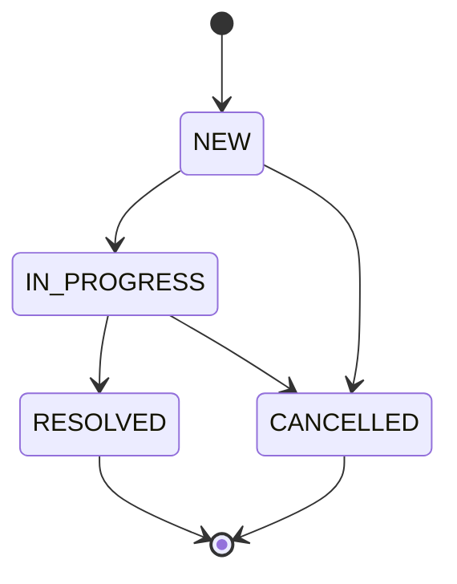
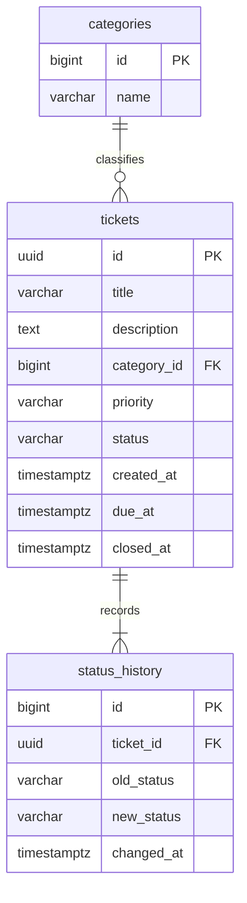

# Спецификация
## Проблема и границы
Обращения теряются между каналами, сроки и отчётность ведутся вручную. Сотрудник регистрирует обращение, специалист обрабатывает его, руководитель просматривает статистику. Один REST-сервис и PostgreSQL. Авторизация, интеграция каналов и пользовательский интерфейс находятся за границами учебного проекта.

## Истории и критерии приёмки
| ID | История | Проверяемый критерий |
|---|---|---|
| US1 | Сотрудник регистрирует заявку | POST возвращает 201, UUID, NEW; пустой заголовок или категория дают 400 |
| US2 | Специалист просматривает заявку | Существующий UUID возвращает 200; неизвестный — 404 |
| US3 | Специалист уточняет описание и срок | PUT меняет описание, приоритет и dueAt; терминальный статус даёт 409 |
| US4 | Специалист ведёт жизненный цикл | NEW → IN_PROGRESS → RESOLVED; отмена из NEW/IN_PROGRESS; остальные переходы дают 409 |
| US5 | Руководитель проверяет историю | Изменение статуса и история сохраняются одной транзакцией; отказ не меняет данные |
| US6 | Специалист ищет обращения | Фильтры status, priority, categoryId, overdue применяются совместно; page от 0, size 1–100 |
| US7 | Сотрудник выбирает категорию | GET categories возвращает справочник; неизвестная категория при создании даёт 400 |
| US8 | Руководитель получает отчёт | Единая выборка createdAt в [from,to); распределения текущие; среднее только RESOLVED; без них null |

## Требования
Заголовок обязателен и ограничен 200 символами. Описание обязательно, допускает пустую строку, максимум 20000 символов. Приоритет LOW/MEDIUM/HIGH обязателен. Срок допускает null. Время хранится в UTC. Равенство срока текущему моменту ещё не означает просрочку. Закрытие и отмена устанавливают closedAt. Создание тоже записывается в историю.
Воспроизводимость обеспечивают Wrapper, закреплённые версии и Compose. Данные сохраняются в именованном томе. Ошибки 400/404/409 имеют поля timestamp,status,message,path. Пароли поступают из окружения. Конкурентные изменения одной заявки сериализуются SELECT FOR UPDATE в транзакции.

## Процесс

## ER

